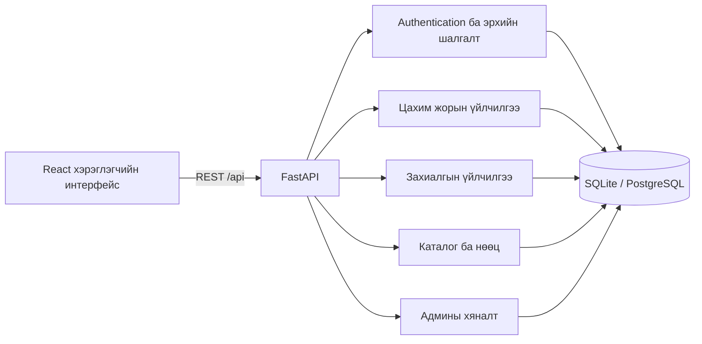
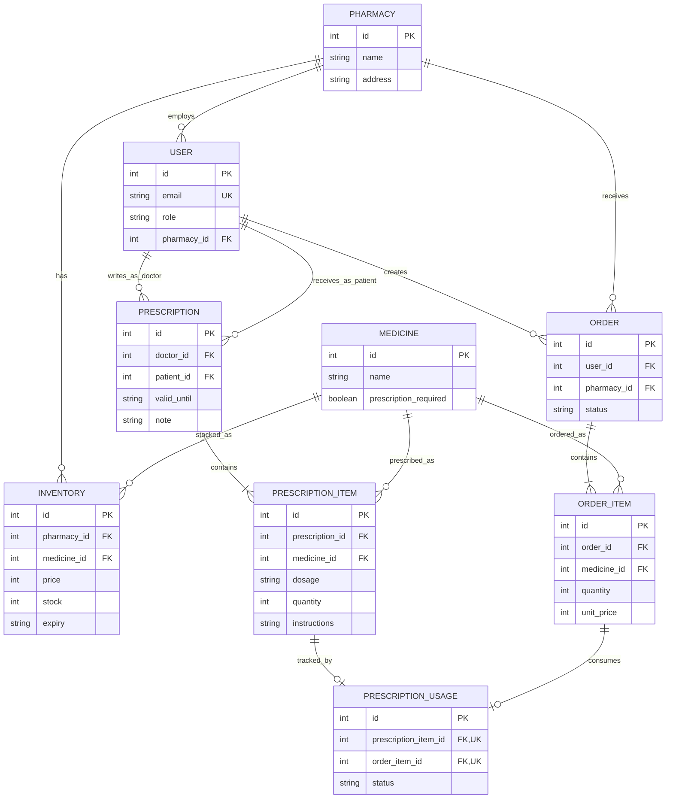

# Системийн архитектур

## Зорилго ба хамрах хүрээ

Энэ систем нь олон эмийн сангийн үнэ, үлдэгдлийг харьцуулж захиалга үүсгэх дипломын туршилтын прототип. Бодит төлбөр, хүргэлт болон цахим жорын улсын системтэй холболт хийхгүй.

## Бүрэлдэхүүн

- **React + Vite:** хэрэглэгч, эмч, эм зүйч, админы role-based интерфейс
- **FastAPI:** authentication, каталог, цахим жор, захиалга, нөөц, админы REST API
- **SQLAlchemy:** development үед SQLite, public deployment үед PostgreSQL
- **ItsDangerous token:** 24 цагийн хүчинтэй, гарын үсэгтэй session token

## Өгөгдлийн загвар

## Цахим жорын урсгал

1. `doctor` эрхтэй хэрэглэгч бүртгэлтэй `customer`-ийг сонгож, зөвхөн `prescription_required=true` эмд жор бичнэ.
2. Жор өвчтөний **Миний цахим жор** хэсэгт `active` төлөвтэй харагдана.
3. Өвчтөн жортой эм захиалахад сервер эм, тоо ширхэг, өвчтөн, хүчинтэй хугацаа, ашиглагдаагүй эсэхийг шалгана.
4. Тохирох жорыг захиалгын мөртэй нэг удаагийн холбоосоор холбож `reserved` төлөвт оруулна.
5. Эм зүйч захиалгыг баталбал холбоос `used`; татгалзвал холбоос устаж жор дахин `active` болно.
6. Хугацаа өнгөрсөн, ашигласан эсвэл хүрэлцэх тоо ширхэггүй жороор захиалга үүсгэхгүй.

## Захиалга батлах урсгал

1. Хэрэглэгч нөөц болон хугацааг шалгуулж `pending` захиалга үүсгэнэ.
2. Тухайн эмийн сангийн эм зүйч л уг захиалгыг харна.
3. Батлах үед сервер захиалгыг атомикаар `processing` төлөвт claim хийнэ.
4. Нөөц бүрийг `stock >= quantity` нөхцөлтэй атомик `UPDATE`-аар хасна.
5. Аль нэг нөөц хүрэлцэхгүй бол transaction бүхэлдээ rollback хийгдэж захиалга `pending` хэвээр үлдэнэ.
6. Амжилттай бол захиалга `approved`, татгалзвал `rejected` болно.

## Эрхийн загвар

- `customer`: каталог болон өөрт ирсэн цахим жорыг харах; захиалга үүсгэх үед жор автоматаар шалгуулах
- `doctor`: бүртгэлтэй хэрэглэгчийг хайх, цахим жор бичих, өөрийн бичсэн жорыг харах
- `staff`: зөвхөн `pharmacy_id`-аар харьяалсан эмийн сангийн захиалга, нөөцийг харах/өөрчлөх
- `admin`: системийн тоон хураангуй, хэрэглэгч болон сүүлийн захиалгуудыг харах
- Өөр эмийн сангийн resource-д хандахад мэдээлэл задруулахгүйгээр `404` буцаана.

## Production хувилбарт шаардлагатай ажил

- Database schema migration framework (Alembic)
- Улсын цахим жорын системтэй баталгаажсан интеграц, эмчийн лицензийн шалгалт
- MFA, login rate limiting, password reset, token revoke
- Audit log болон хувийн мэдээлэлд хандсан түүх
- HTTPS, secret manager, backup/restore төлөвлөгөө
- Төлбөр ба хүргэлтийн тусдаа интеграц
